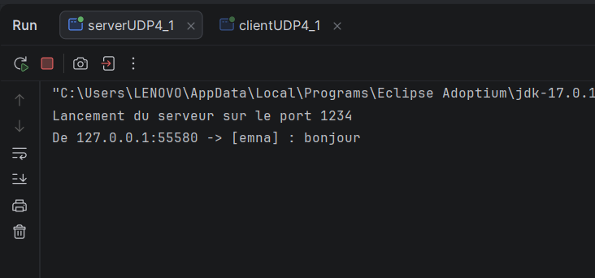
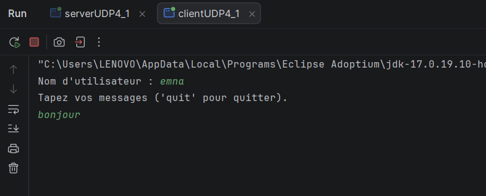
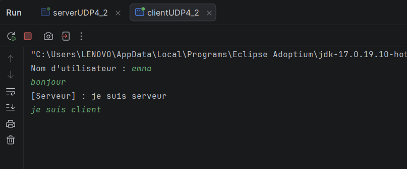
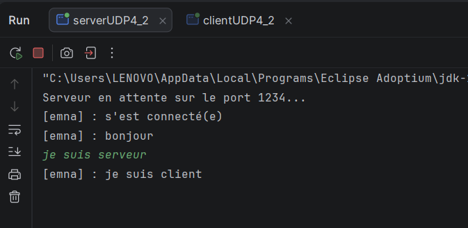
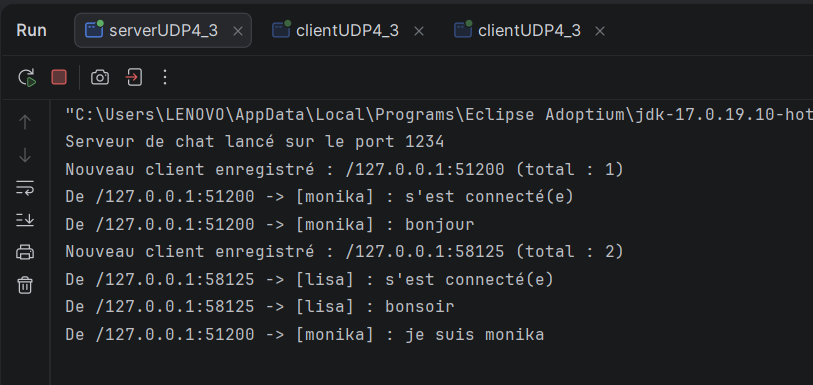
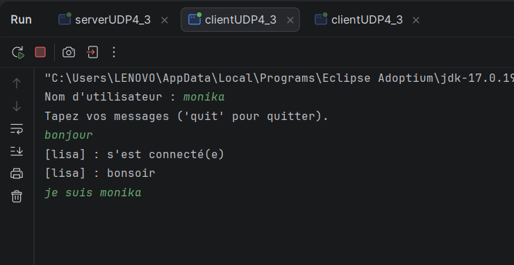
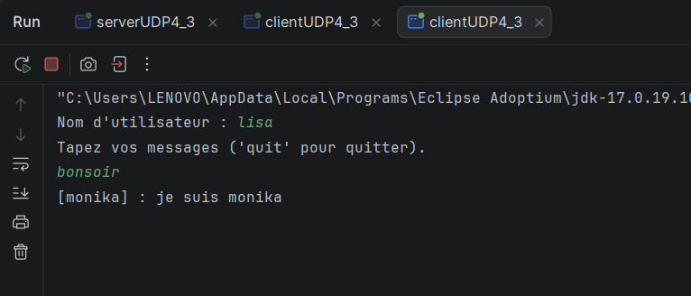

# TP4 : Sockets en mode non connecté (UDP) — Service de chat client/serveur

## 1. Objectif

Réaliser un service de chat client/serveur en Java avec `DatagramSocket` et `DatagramPacket` (protocole UDP, mode non connecté), en trois étapes :

**cas 1** : chat unidirectionnel (le client envoie, le serveur affiche) 

**cas 2** : un serveur et un client qui s'écrivent dans les deux sens 

**cas 3** : chat à plusieurs clients, le serveur diffuse chaque message aux autres.

## chat unidirectionnel

### Serveur (`serverUDP4_1`)

Le serveur lie sa socket au port 1234, puis attend les messages avec `receive()` dans une boucle infinie. Pour chaque paquet, il affiche le texte reçu avec l'adresse et le port de l'expéditeur.

### Client (`clientUDP4_1`)

Le client demande un nom d'utilisateur, puis envoie chaque ligne saisie au serveur sous la forme `[nom] : texte`, avec `send()`.

`

`

##  Chat bidirectionnel (un serveur, un client)

### Principe

Le serveur et le client peuvent tous deux écrire et recevoir à tout moment. Or `receive()` et `Scanner.nextLine()` sont **bloquants** : avec un seul thread, on resterait bloqué sur l'un et on manquerait l'autre. Chaque côté utilise donc :

- un **thread de réception** (daemon) qui boucle sur `receive()` et affiche les messages ;
- le **thread principal** qui lit le clavier et envoie avec `send()`.

### Serveur (`serverUDP4_2`)

Le serveur mémorise l'adresse du client dès qu'il reçoit son premier message, puis lui envoie les messages saisis au clavier. Un thread dédié reçoit pendant que le thread principal envoie.

### Client (`clientUDP4_2`)

Le client envoie un message d'annonce à la connexion, ce qui permet au serveur de connaître son adresse. Un thread reçoit les messages pendant que le thread principal lit le clavier et envoie.

##  chat avec plusieurs clients

### Serveur (`serverUDP4_3`)

Le serveur garde la liste des clients dans un `Set<SocketAddress>` : chaque nouvel expéditeur y est ajouté. Pour chaque message reçu, il le renvoie à tous les clients sauf à celui qui l'a envoyé.

### Client

Le client est le même que pour le chat bidirectionnel (`clientUDP4_2`). On en lance plusieurs instances pour simuler plusieurs utilisateurs.

